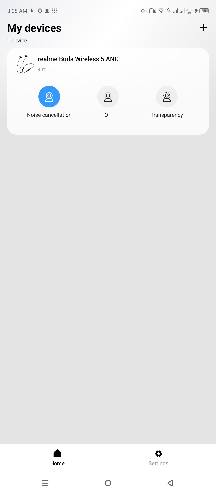
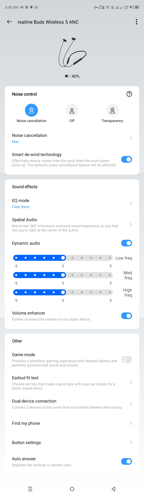
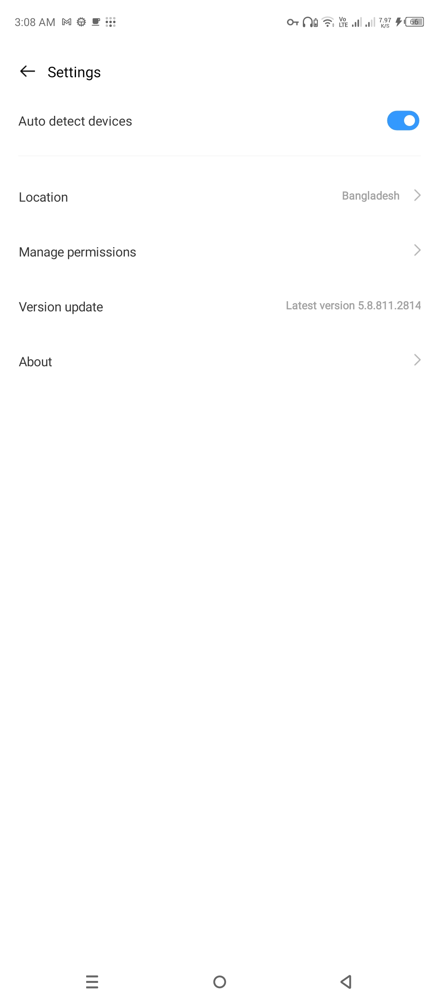

# Realme Link - DeVanced

> A cleaner version of Realme Link — from a loyal user of Realme.
>
> Reverse engineering and analysis done with **[REA](https://github.com/morluto/rea)**
> (Reverse Engineer Anything). Thanks to the REA project.

**DeVanced** here means *de-noised*: the same realme Link, minus account walls, promos, consent nags and clutter. Device control stays.

> **Disclaimer** — Not affiliated with or endorsed by realme. For personal use on
> your own device only. Do not redistribute the re-signed proprietary app. The
> original APK is the property of its copyright holder.

---

## Features

1. **No account login** — opens straight to Home; login gates are bypassed on add-device, headset and device flows. Local BLE/device control works; cloud sync, mall, messages and health sync don’t.
2. **Clean Home** — no virtual-experience strip, Smart AI card, health trends, weather/location row, notification bell/dot, or banner-theme guide.
3. **Accurate device card** — shows the real connection and battery state instead of “Not used” / “Device not connected”.
4. **Minimal navigation** — Health and Workout tabs removed; Me replaced by a Settings button (black gear) that opens Settings directly.
5. **Direct, full-screen device page** — one tap opens ANC / EQ / spatial-audio controls; no Quick guide, no task restart, no per-device Statement of Use.
6. **No floating windows** — phone-mode overlays disabled globally; device page, Device details (3-dot) and other pages fill the screen.
7. **Cleaner Add device** — no virtual-device banner, no Band/Watch manual section, no login gate.
8. **No rating/feedback prompt.**
9. **Minimal Settings** — removed notification status, App protection, third-party sync, Account management, Personal Info We Collect, Personal Info We Share with Third Parties.
10. **Minimal About** — removed Privacy Notice, Service Agreement, Open source licenses, User Experience Program/notice and Withdraw consent; shows only icon + version.
11. **Renamed and coexisting** — “Realme Link DeVanced” (`com.realme.devanced`), installed alongside the official app.
12. **Tighter layout** — header min-height and dead space removed; responsive 9 dp gap above the device list.

Everything that makes it a device tool still works: pairing/scanning, ANC, EQ, spatial audio, firmware/device details, battery status, region selection, permissions and updates.

## Screenshots

<table>
  <tr>
    <td align="center" valign="top">
      <br>
      <sub><b>Home</b> — one device, live status, no promo cards, no notification bell</sub>
    </td>
    <td align="center" valign="top">
      <br>
      <sub><b>Device</b> — full-screen page (ANC, sound effects, other controls), no floating dialog</sub>
    </td>
    <td align="center" valign="top">
      <br>
      <sub><b>Settings</b> — only the useful rows; the noise is gone</sub>
    </td>
  </tr>
</table>

---

## Target identity

| Field | Original | Clone |
|---|---|---|
| Package | `com.realme.link` | `com.realme.devanced` |
| Version | `5.8.811.2814` / `530214` | same |
| Label | `realme Link` | `Realme Link DeVanced` |
| Signer | realme (`CN=ROM, O=realme`) | personal key (`rea-mod`) |
| Install shape | base + 14 split APKs | same split set, re-signed |
| min / target SDK | 26 / 36 | 26 / 36 |

`com.realme.devanced` is longer than `com.realme.link`, so the manifest string
pool is resized (offsets recalculated) by `patch_axml_rename.py` instead of
using equal-length byte replacement.

---

## Repository layout

```
.
├── CLAUDE.md                              # guidance for Claude Code in this repo
├── README.md
├── app/                                   # ignored: target APKs (proprietary)
├── patcher-app/                           # on-device patcher source (payload built locally)
├── rea-src/                               # ignored: local clone of the REA tool source
└── work/
    ├── MAP-realme-link-5.8.md             # app-shell architecture map
    ├── PATCH-RECIPE-realme-link-5.8.md    # canonical patch catalog + build pipeline
    └── patcher/
        ├── README.md                      # script order of operations
        ├── patch_axml.py                  # equal-length manifest string patcher
        ├── patch_arsc.py                  # equal-length resources.arsc string patcher
        ├── patch_arsc_rename.py           # variable-length rename (resizes string pool)
        ├── swap_dex.py                    # dex swap into the original base
        ├── patch_setting_img.py           # settings-icon vector color patch
        ├── build_clone_split.py           # original end-to-end harness
        ├── patch_map.json                 # package/authority mapping
        └── arsc_map.json                  # resource string mapping
```

Decoded trees (`work/base58/apktool-out/`, jadx output) and `/tmp` build artifacts
are intentionally not tracked — they are large and reproducible.

---

## Documentation

| Document | Contents |
|---|---|
| [`work/PATCH-RECIPE-realme-link-5.8.md`](work/PATCH-RECIPE-realme-link-5.8.md) | Every patch (§3.1–§3.24), build steps, on-device patcher design, pitfalls |
| [`work/MAP-realme-link-5.8.md`](work/MAP-realme-link-5.8.md) | Startup flow, tab shell, WebView bridge, telemetry, ads, permissions, update/integrity paths |
| [`work/patcher/README.md`](work/patcher/README.md) | Script usage and order of operations |

Read the patch recipe before changing anything; it records the exact smali sites
and the reasons behind each edit.

---

## Toolchain

- JDK 21
- [apktool](https://apktool.org/) 3.0.3
- [jadx](https://github.com/skylot/jadx) 1.5.6
- Android build-tools 35: `aapt2`, `apksigner`, `zipalign`
- `adb` with a connected arm64 Android device
- Python 3 (standard library only for the patcher scripts)

The signing key is local (`~/.local/opt/rea-mod.keystore`, alias `rea-mod`); the
password file is not part of this repository.

---

## Build and install

The final APK is always assembled from the **original base APK**, with only the
patched `classes*.dex` swapped in. `apktool b` is used only to produce dex files:
its rebuilt resources drop the shared resource packages (`0x80`–`0x84`) and are
discarded.

```bash
# 0. pull the installed split bundle (personal device)
adb shell pm path com.realme.link
# pull base.apk and every split_*.apk into /tmp/pulled-realme-link/

# 1. decode the base once, keeping dex files as files
apktool d -s -f -o work/base58/apktool-out /tmp/pulled-realme-link/base.apk

# 2. apply smali patches under work/base58/apktool-out/smali*/
#    (patch IDs and snippets are in the recipe)

# 3. rebuild dex
apktool b work/base58/apktool-out -o /tmp/base-mod-build.apk

# 4. swap only the dex that changed into the current (already renamed) base
#    classes36 = account/login · classes38 = app shell · classes40 = headset/device
python3 -I work/patcher/swap_dex.py /tmp/base-devanced.apk /tmp/base-mod-build.apk \
    /tmp/base-mod-new-unsigned.apk classes38.dex

# 5. align + sign (base and every split must use the same key)
zipalign -p -f 4 /tmp/base-mod-new-unsigned.apk /tmp/base-mod-new-aligned.apk
apksigner sign --ks ~/.local/opt/rea-mod.keystore \
    --ks-pass "pass:$(cat ~/.local/opt/rea-mod.pass)" \
    --key-pass "pass:$(cat ~/.local/opt/rea-mod.pass)" \
    --ks-key-alias rea-mod --out /tmp/base-mod-new.apk \
    /tmp/base-mod-new-aligned.apk

# 6. install the whole bundle. The clone is a separate package, so the official
#    app can stay installed; -r keeps the clone's data on later updates.
adb shell am force-stop com.realme.devanced
adb install-multiple -r --no-incremental /tmp/base-mod-new.apk \
    /tmp/clone-devanced-signed/split_*.apk
adb shell cmd package compile -m speed -f com.realme.devanced   # improves cold start
```

### First-time clone setup

1. Rename package, authorities and permission in the base **and all splits**:
   - equal-length names: `patch_axml.py` with `patch_map.json`
   - any length (current `com.realme.devanced`): `patch_axml_rename.py`, which
     resizes the manifest string pool and fixes all offsets.
2. Rename the launcher label with `patch_arsc_rename.py`.
3. Sign all 15 APKs with one key, then `adb install-multiple`.
4. Keep the official app installed alongside — that is the point of the clone.

---

## Patcher scripts

All scripts are dependency-free and accept file paths; run them with
`python3 -I` so untrusted APK data cannot shadow imports.

| Script | Purpose |
|---|---|
| `patch_axml.py <apk> <map.json> <out>` | Equal-length string-pool replacement in binary `AndroidManifest.xml` (package/authorities). Apply to base **and every split**. |
| `patch_axml_rename.py <in> <out> <old> <new>` | Package-prefix rename of **any** length: rebuilds the manifest string pool, its offsets and the XML header. Apply to base **and every split**. |
| `patch_arsc.py <apk> <map.json> <out>` | Equal-length string replacement in `resources.arsc`. |
| `patch_arsc_rename.py <in> <out> <old> <new>` | Rename a resource string of **different** length by resizing the global string pool and fixing all following offsets. |
| `swap_dex.py <original> <patched> <out> [dex…]` | Replace `classes*.dex` entries in the original APK (default: 36, 37, 38, 40). |
| `patch_setting_img.py <in> <out>` | Make `res/drawable/setting_img.xml` a transparent circle with a black gear. |
| `build_clone_split.py` | Original end-to-end harness (dex swap + manifest patch + align + sign). |

---

## On-device patcher (local build)

`patcher-app/` builds **`RealmeDevancedPatcher_v5.8.811.2814.apk`** (app label
“Realme Devanced Patcher”), a no-root patcher that reads the *installed* realme
Link bundle, applies the patched `classes36/37/38/40.dex`, renames the package to
`com.realme.devanced`, re-signs every APK and stores the bundle in the patcher’s
private storage. Patching shows animated steps and ends with an **Install**
button (it does not launch the installer automatically); the button remains on
later launches while the stored bundle exists. The official app stays installed;
when the install completes the patcher tells the user:

> Now you can delete the original realme Link if you want.

```bash
BASE_APK=/tmp/base-devanced.apk ./patcher-app/build.sh
```

The built APK embeds patched realme dex, so it is **personal-use only** and is
not committed or published — only the patcher source is tracked.

## Verification

```bash
adb exec-out screencap -p > /tmp/shot.png
adb shell uiautomator dump /sdcard/ui.xml && adb pull /sdcard/ui.xml /tmp/ui.xml
aapt2 dump badging /tmp/base-mod-new.apk | grep -E "package:|application-label:"
adb logcat -b crash | grep com.realme.devanced
adb shell pidof com.realme.devanced
```

Things that are easy to miss:

- A “crash” on device tap was actually a task restart (`DeviceUtils.w()` sends
  `MAIN | CLEAR_TASK`). Check `ActivityTaskManager` start flags, not only
  `FATAL EXCEPTION`.
- `Fragment.findViewById` does not exist here — use `getView().findViewById`.
- ConstraintLayout stores its own `mMinHeight`; `View.setMinimumHeight()` does not
  clear `android:minHeight`.
- Hiding `ConstraintLayout` chain members can make the remaining anchors collapse
  and overlap; hide the leftovers or re-anchor.

The full checklist is in the patch recipe (§5), and the pitfalls are in §7.

---

## Known limitations

- The clone has no account, so cloud-dependent features fail silently.
- The `realmeHeadset` dynamic module is not in the pulled bundle; the clone loads
  its resources via `addAssetPath()` and bypasses the headset login gates.
- The clone never receives official updates; re-patch a new official version and
  reinstall the split set instead. It stays a separate package from the official
  app.
- The official app’s `allowBackup=false` means uninstalling it loses local data.

---

## Credits

Reverse engineering, APK inspection and the analysis workflow behind the app map
and patch recipe were done with **[REA — Reverse Engineer Anything](https://github.com/morluto/rea)**.
Thanks to the REA author and contributors for making this kind of tooling
available.

Realme Link DeVanced is a cleaner version of Realme Link, made by a loyal Realme
user for personal use. It is not affiliated with, endorsed by, or supported by
realme.

## Branching

- `development` — working branch for new patches.
- `main` — released/latest state, fast-forwarded from `development`.

Commit documentation and patcher scripts only. Never commit decoded artifacts,
target APKs, keystores or passwords.
